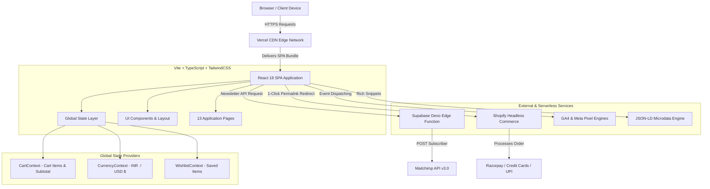
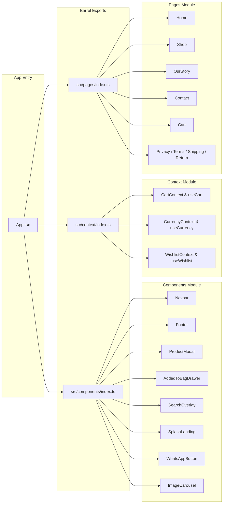
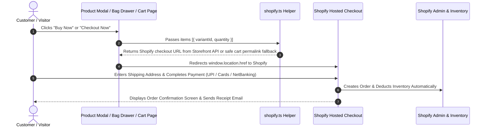
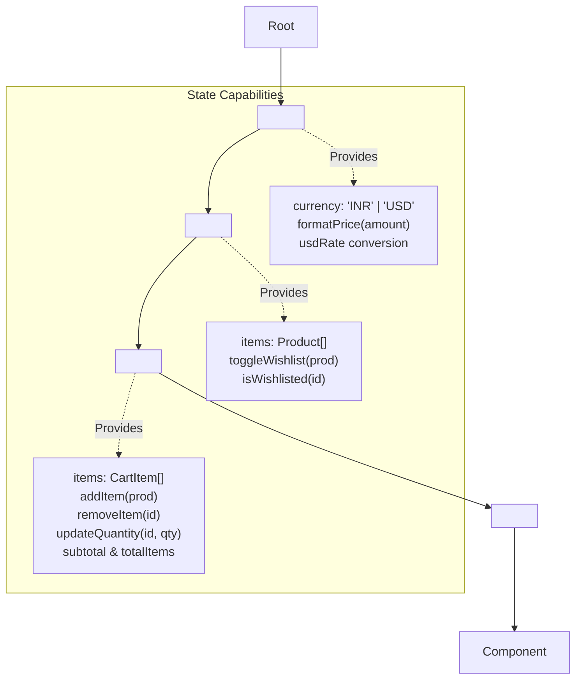
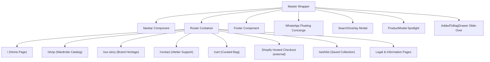

# Brown Buti — Contemporary Silk Saree E-Commerce Storefront

> **A Collection of Stories, Stitched in Silk.**  
> A high-end, headless React 18 + Vite + TypeScript e-commerce platform crafted with bespoke luxury aesthetics, custom storytelling UI components, headless Shopify commerce integration, Supabase Edge Functions, and enterprise-grade SEO & analytics.

---

## Table of Contents
1. [Executive Overview & Brand Philosophy](#-executive-overview--brand-philosophy)
2. [System Architecture & Visual Diagrams](#-system-architecture--visual-diagrams)
   - [2.1 High-Level Platform Architecture Flowchart](#21-high-level-platform-architecture-flowchart)
   - [2.2 Modular Barrel Export & Component Dependency Graph](#22-modular-barrel-export--component-dependency-graph)
   - [2.3 User Checkout & Shopify Permalink Sequence Diagram](#23-user-checkout--shopify-permalink-sequence-diagram)
   - [2.4 Global State & Context Provider Hierarchy](#24-global-state--context-provider-hierarchy)
   - [2.5 Page Routing & Component Layout Map](#25-page-routing--component-layout-map)
3. [Complete Codebase Walkthrough & File Inventory](#-complete-codebase-walkthrough--file-inventory)
4. [Key Features & Technical Innovations](#-key-features--technical-innovations)
5. [Setup & Local Development Guide](#-setup--local-development-guide)
6. [E-Commerce & Third-Party Integrations](#-e-commerce--third-party-integrations)
7. [Comprehensive Launch Audit: What is Done vs. What is Left](#-comprehensive-launch-audit-what-is-done-vs-what-is-left)

---

## Executive Overview & Brand Philosophy

**Brown Buti** is a contemporary luxury saree brand celebrating artisan-crafted silk, bespoke motif design, and heritage storytelling. The web application is engineered to evoke the experience of a high-end fashion atelier, combining warm cream and mocha color palettes (`#FAF7F2`, `#FFFEF7`, `#1E140A`), dynamic silk video loops, elegant typography (`Cinzel`, `Playfair Display`, `Lora`), and zero-friction purchase flows. Legacy Mocha & Mogra domain, contact mailbox, Shopify identifiers, and service configuration are intentionally retained until approved replacements are ready.

### Technical Architecture Highlights
- **Headless Commerce Stack**: React 18 SPA built with Vite and TypeScript, paired with Shopify as a headless backend for inventory, order processing, and tax compliance.
- **Modular Barrel Architecture**: Clean, scalable component, page, and context organization powered by TypeScript barrel exports (`index.ts`).
- **Hardware-Accelerated UI Motion**: Smooth page transitions, slide-over drawers, and interactive modals built with `framer-motion` and `lucide-react` icons.
- **Serverless Edge Layer**: Supabase Edge Functions running on Deno for serverless API integrations (Mailchimp newsletter synchronization).
- **Automated Rich Snippet Engine**: Zero-overhead JSON-LD Schema.org microdata injection (`Organization`, `Product`, `ItemList`, `BreadcrumbList`) for rich search engine result snippets.
- **Dual Conversion Tracking**: Unified event dispatching system supporting Google Analytics 4 (GA4) and Meta Pixel (Facebook).

---

## System Architecture & Visual Diagrams

### 2.1 High-Level Platform Architecture Flowchart



---

### 2.2 Modular Barrel Export & Component Dependency Graph



---

### 2.3 User Checkout & Shopify Permalink Sequence Diagram



---

### 2.4 Global State & Context Provider Hierarchy



---

### 2.5 Page Routing & Component Layout Map



---

## Complete Codebase Walkthrough & File Inventory

```
Brown-Buti/
├── .env.example                 # Environment variables template
├── .github/
│   └── workflows/
│       └── supabase-deploy.yml  # Automated deployment workflow for Supabase Edge Functions
├── index.html                   # HTML entry point with CSP headers, SEO meta & Google Fonts
├── package.json                 # Project manifest, dependencies, and build scripts
├── postcss.config.js            # PostCSS configuration for TailwindCSS processing
├── public/                      # Public static assets & brand logos
│   ├── images/
│   │   ├── brown-buti-logo.webp # Full transparent Brown Buti wordmark
│   │   ├── brown-buti-mark.webp # Transparent emblem for compact UI use
│   │   └── mnmlogo-Photoroom.webp # Retained legacy logo asset
│   └── favicon.ico
├── README.md                    # Main repository documentation & architectural manual
├── src/
│   ├── App.tsx                  # Master application layout, route definitions & provider tree
│   ├── index.css                # Global design system tokens, typography rules & Tailwind imports
│   ├── main.tsx                 # React 18 DOM mount point with analytics initializer
│   ├── vite-env.d.ts            # Vite TypeScript declarations
│   ├── components/              # Modular UI Component Library
│   │   ├── index.ts             # Central barrel export for all UI components
│   │   ├── AddedToBagDrawer.tsx # Slide-over bag drawer with checkout trigger
│   │   ├── Footer.tsx           # Brand footer with newsletter subscription form
│   │   ├── ImageCarousel.tsx    # Arch-styled media carousel with WebM video support
│   │   ├── Navbar.tsx           # Sticky luxury header with currency toggle & cart badge
│   │   ├── ProductModal.tsx     # Full product detail drawer with story & 1-click Buy Now
│   │   ├── SearchOverlay.tsx    # Modal overlay for real-time catalog search
│   │   ├── SplashLanding.tsx    # Animated opening splash screen
│   │   └── WhatsAppButton.tsx   # Floating concierge WhatsApp CTA button
│   ├── context/                 # React Context Providers for Global State
│   │   ├── index.ts             # Central barrel export for providers and custom hooks
│   │   ├── CartContext.tsx      # Cart item manipulation, quantity updates & subtotal
│   │   ├── CurrencyContext.tsx  # Global currency (INR/USD) & price formatting logic
│   │   └── WishlistContext.tsx  # Persistent wishlist state & toggle handlers
│   ├── data/
│   │   └── products.ts          # Catalog data model & product inventory array
│   ├── lib/                     # Core Utility & Integration Libraries
│   │   └── brand.ts              # Current customer-facing brand name, logo and tagline
│   │   ├── analytics.ts         # Dual GA4 & Meta Pixel conversion tracking engine
│   │   ├── jsonld.tsx           # SEO Schema.org structured data helpers
│   │   ├── shopify.ts           # Shopify Headless API & cart permalink generator
│   │   └── supabase.ts          # Supabase client initialization wrapper
│   └── pages/                   # Application Page Views
│       ├── index.ts             # Central barrel export for all application pages
│       ├── Cart.tsx             # Curated shopping cart page with order summary
│       ├── Contact.tsx          # Brand atelier contact page with validation
│       ├── Home.tsx             # Homepage hero, brand narrative & featured sarees
│       ├── OurStory.tsx         # Brand heritage & artisanal philosophy page
│       ├── Privacy.tsx          # Privacy policy legal document
│       ├── ReturnPolicy.tsx     # Return & exchange policy legal document
│       ├── ShippingPolicy.tsx   # Domestic & international shipping policy
│       ├── Shop.tsx             # Complete wardrobe catalog with motif & price filters
│       ├── SizeGuide.tsx        # Saree drape & blouse sizing guide
│       ├── Terms.tsx            # Terms of service legal document
│       └── Wishlist.tsx         # Saved items wishlist gallery
├── supabase/
│   ├── config.toml              # Supabase CLI project configuration
│   └── functions/
│       └── subscribe-mailchimp/ # Deno edge function for newsletter sync
│           ├── index.ts
│           └── deno.json
├── tailwind.config.js           # Custom luxury color palette & typography tokens
├── TECHNICAL_DEPENDENCIES_AND_ARCHITECTURE.md # Technical reference manual
├── tsconfig.json                # TypeScript project configuration
├── vercel.json                  # Vercel SPA routing rewrite rules
└── vite.config.ts               # Vite build configuration
```

---

## Key Features & Technical Innovations

### 1. Luxury Media & Product Discovery
- **Arch-Shaped Media Carousels**: Custom aspect ratio image and WebM video carousels honoring traditional Indian architectural motifs.
- **Multi-Faceted Catalog Filtering**: Filter sarees by category (`Saree` / `Underskirt`), motif themes (Fish, Pineapple, Owl, Elephant, Seahorse), and price ranges.
- **Interactive Search Engine**: Instant keyboard-accessible modal overlay filtering products in real time across titles, motifs, and descriptions.

### 2. Dual Currency Engine (INR / USD $)
- Global currency switcher in `Navbar` updating prices across all catalog views, product modals, and bag drawers.
- Dynamic complimentary shipping calculation: Complimentary shipping across India for orders above 5,000; international threshold dynamically adjusted according to live exchange rates.

### 3. Headless Shopify Integration
- Direct 1-click cart permalinks (`/cart/variant_id:qty`) linking straight into Shopify's checkout engine.
- Shopify Storefront API checkout URL with a validated cart-permalink fallback; invalid variant IDs are rejected with a clear error.

### 4. Enterprise SEO & Analytics
- Dynamic `JSON-LD` microdata injection (`Organization`, `Product`, `ItemList`, `BreadcrumbList`).
- Dual event dispatching to Google Analytics 4 (`gtag`) and Meta Pixel (`fbq`) for product views, add-to-cart, and checkout initiation. Payment processing stays on Shopify.

---

## Setup & Local Development Guide

### Prerequisites
- **Node.js**: v18.0.0 or higher
- **npm**: v9.0.0 or higher

### 1. Installation

```bash
git clone https://github.com/Nutricalboii/Brown-Buti.git
cd Brown-Buti
npm install
```

### 2. Environment Configuration

Create a `.env` file in the root directory (refer to `.env.example`):

```env
# Shopify Headless Credentials
VITE_SHOPIFY_STORE_DOMAIN=1fieuf-bz.myshopify.com
VITE_SHOPIFY_STOREFRONT_ACCESS_TOKEN=your_storefront_access_token

# Analytics Configuration (Optional for local dev)
VITE_GA4_MEASUREMENT_ID=G-XXXXXXXXXX
VITE_META_PIXEL_ID=1234567890

# Supabase Edge Functions (Optional for local dev)
VITE_SUPABASE_URL=https://your-supabase-project.supabase.co
VITE_SUPABASE_ANON_KEY=your_supabase_anon_key
```

### 3. Available npm Scripts

| Command | Action |
|---|---|
| `npm run dev` | Starts Vite local development server (`http://localhost:5173`) |
| `npm run build` | Builds optimized production bundle in `dist/` |
| `npm run preview` | Previews production build locally |
| `npm run typecheck` | Runs TypeScript type checking without emitting files |

---

## E-Commerce & Third-Party Integrations

### 1. Headless Shopify Direct Checkout
The application utilizes Shopify's **Cart Permalink Format**. When a customer clicks **"Buy Now"** or **"Checkout Now"**, the helper in `src/lib/shopify.ts` constructs a direct URL:

```typescript
// Example constructed URL for real variant IDs:
https://1fieuf-bz.myshopify.com/cart/4567890123:1,4567890124:2

// The storefront API-unavailable fallback uses the same Shopify cart permalink format.
https://1fieuf-bz.myshopify.com/cart/4567890123:1
```

The React storefront contains no payment gateway or payment API. Checkout, payment gateway configuration (if enabled), order receipts, and order management are handled by Shopify.

### 2. Supabase + Mailchimp Newsletter Subsystem
Newsletter subscriptions submitted in `Footer.tsx` trigger the Supabase Edge Function located at `supabase/functions/subscribe-mailchimp/index.ts`:
1. Verifies CORS preflight headers (`OPTIONS`).
2. Inserts the subscriber email into Supabase table `newsletter_subscribers`.
3. Sends an authenticated `POST` request to Mailchimp API v3.0 (`https://{DC}.api.mailchimp.com/3.0/lists/{LIST_ID}/members`).

---

## Launch readiness: source status vs. owner-side verification

This is a code repository, not proof that external services are configured. The table below separates locally verifiable implementation from account settings that must be checked by the owner. Do not use old launch steps in archived documents as current instructions.

| Component / Subsystem | Status | Details / Description | Action Required for Production |
|---|---|---|---|
| **Frontend / catalog** | Present in source | Brown Buti identity, product catalog and responsive storefront are implemented in this repository. | Validate the deployed build and product content in the owner-approved preview. |
| **Build / tests** | Locally verifiable | Run `npm run build`, `npm run typecheck`, `npm test`, and `npm run lint`. | Re-run on the exact commit intended for release; address any new failures. |
| **Shopify checkout** | Integration code present; account state unverified here | Storefront hands checkout to Shopify; checkout and payment-provider setup are Shopify-side. | Owner should verify current products, variants, payment provider, checkout and order emails in Shopify Admin. Do not recreate the store or replace IDs. |
| **Shopify public brand settings** | Not changed by this source update | Store name/logo, vendor values, theme, notification templates and customer-care details are external settings. | Apply Brown Buti public display branding after owner review. Keep store domain, product/variant IDs, inventory and orders. |
| **Domains / Vercel** | Existing project aliases preserved | The live Vercel URL remains the canonical host for current source metadata; old custom-domain records are not assumed active. | Verify production project, connected repository, domains and redirects in Vercel before changing aliases or DNS. |
| **Supabase / newsletter** | Integration code present; hosted deployment unverified | Local Supabase CLI slug is `brown-buti`; hosted project reference, URLs and secrets are unchanged. | Verify the deployed function, secrets and allowed origins in the existing project. |
| **SEO / social** | Brand copy and sitemap updated locally | JSON-LD and page metadata identify Brown Buti; sitemap lists the verified Vercel host. Existing social handle remains unchanged. | Submit/inspect the sitemap and review social cards after deployment; change the social profile only after a replacement handle is approved. |
| **GitHub** | Repository renamed | Current repository: `Nutricalboii/Brown-Buti`; history and service integrations are retained. | Verify branch protection and deployment triggers from GitHub settings as needed. |

---

*Documentation maintained by Antigravity AI Engineering Team for Brown Buti.*
